# PR 2 final screenshot review

Date: November 4, 2026

All 18 final production-build screenshots below were saved, opened, and visually inspected. The first six are the required responsive homepage/reader set; the remaining captures cover the public flow and recovery states. Every capture reported zero console errors and no horizontal overflow.

Reproduce with `node scripts/capture-pr2-evidence.mjs` while the production build is served on port 4176. Set `PR2_BASE_URL` to use another production preview. The capture script fails on console errors or overflow.

The images establish visual state, not complete accessibility conformance. Search, navigation, session state, deep links, reload behavior, and responsive reflow are separately covered by the Playwright suite. The six production Lighthouse audits passed; scores, metrics, report links, and limits are recorded in [the Lighthouse results](PR2_LIGHTHOUSE_RESULTS.md).

## 1. Mobile home

390 x 844. Healthy. The quote leads, the photo remains candid, and the title and primary action fit above bottom navigation.

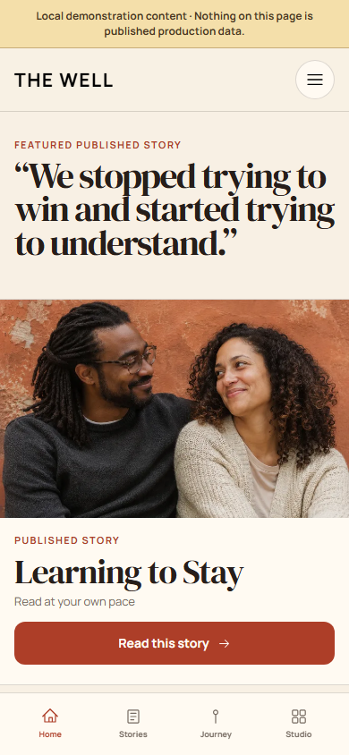

## 2. Tablet home

768 x 1024. Healthy. The stacked editorial layout has readable copy and an accessible primary action; the photograph continues below the fold.

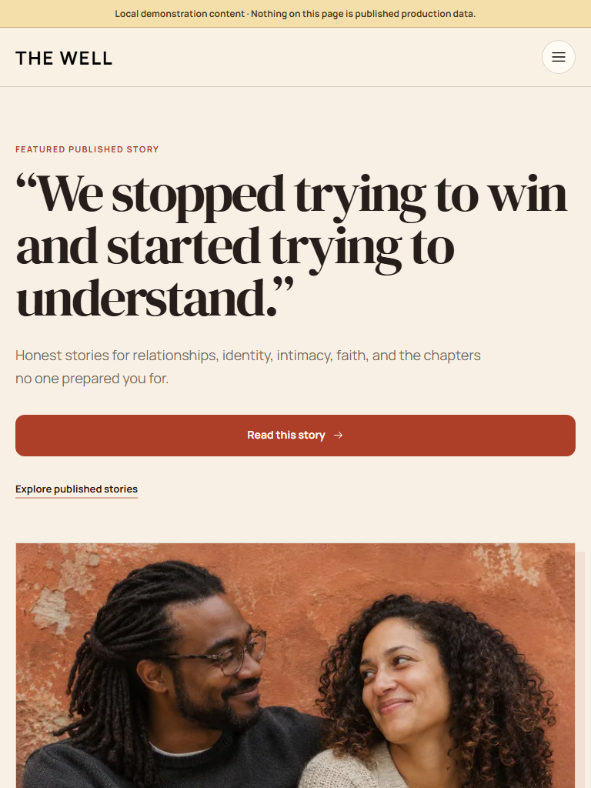

## 3. Desktop home

1440 x 1000. Healthy. Quote and photography balance in two columns; navigation and image caption remain readable.

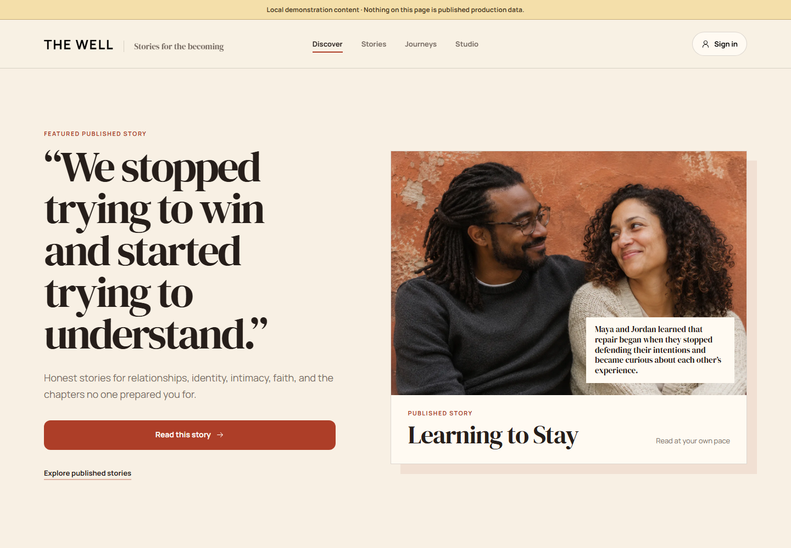

## 4. Large desktop home

1920 x 1080. Healthy. The centered content width prevents excessively long lines on a large display.

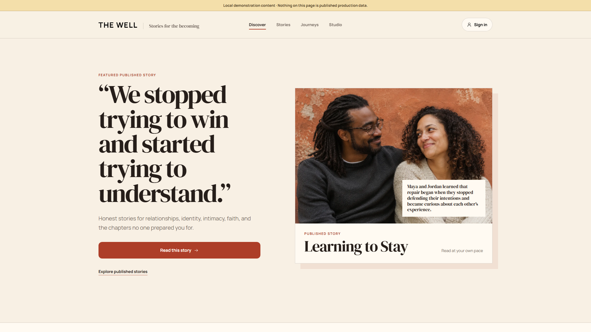

## 5. Mobile reader

390 x 844. Corrected and healthy. The title and introduction now precede the photo. All content remains scrollable above bottom navigation.

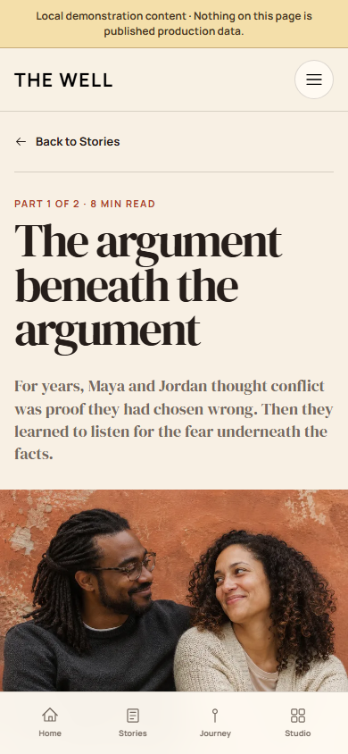

## 6. Desktop reader

1440 x 1000. Healthy. Expressive headline, photograph, and narrow reading column retain the selected hierarchy.

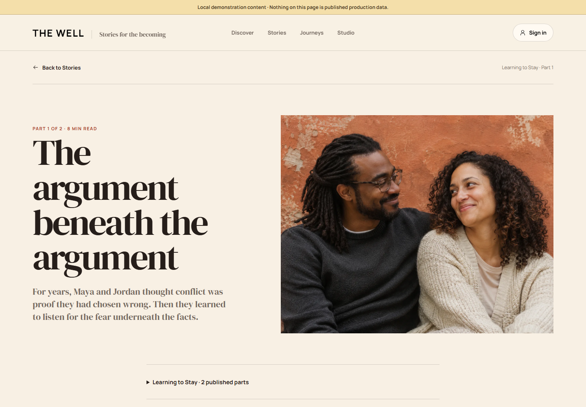

## 7. Mobile library

390 x 844. Corrected and healthy. Reduced headline size and spacing bring search and story imagery higher on the screen.

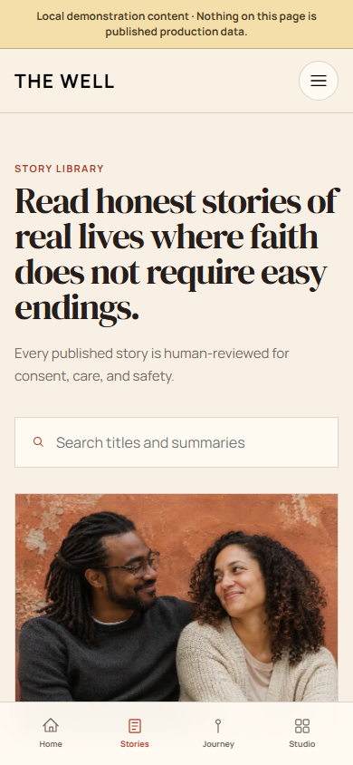

## 8. Desktop library

1440 x 1000. Healthy. Search is clear and the featured card retains image-led editorial treatment.

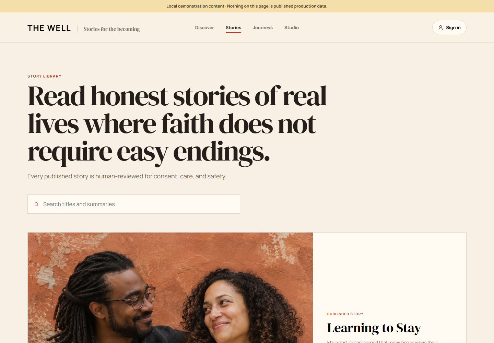

## 9. Search empty

390 x 844. Healthy with scrolling. The empty state gives a clear-search recovery action; that action can be scrolled fully above bottom navigation.

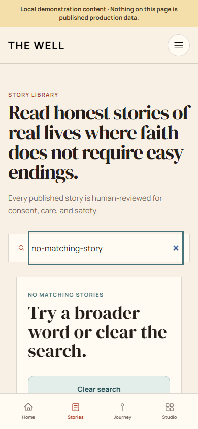

## 10. Reflection

390 x 844. Healthy. Choice, selected state, confirmation, and next-episode action remain visible and distinct.

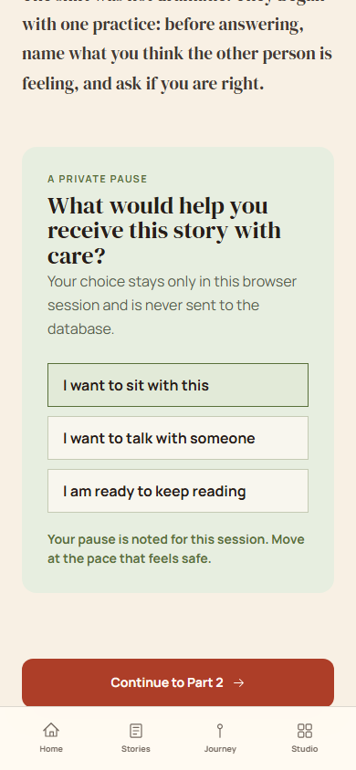

## 11. Episode two

1440 x 1000. Healthy. The second episode presents a new title and opening; previous navigation and reload are covered by tests.

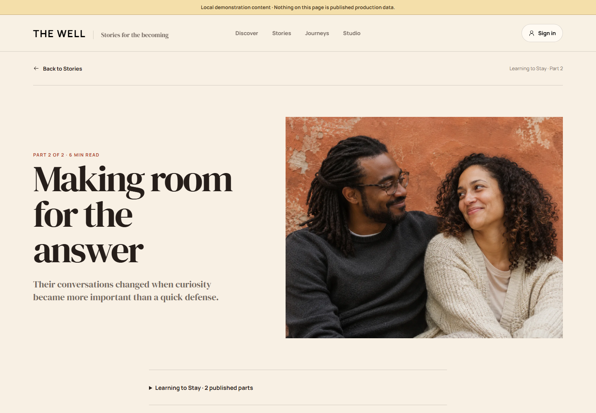

## 12. Journey list

390 x 844. Healthy. The journey remains a quiet editorial invitation with duration and summary.

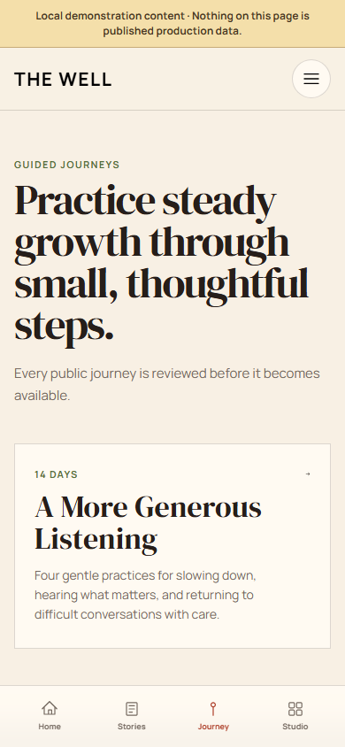

## 13. Journey detail

1440 x 1000. Corrected and healthy. Ordinary language explains temporary private progress; ordered steps remain secondary to the story-led site.

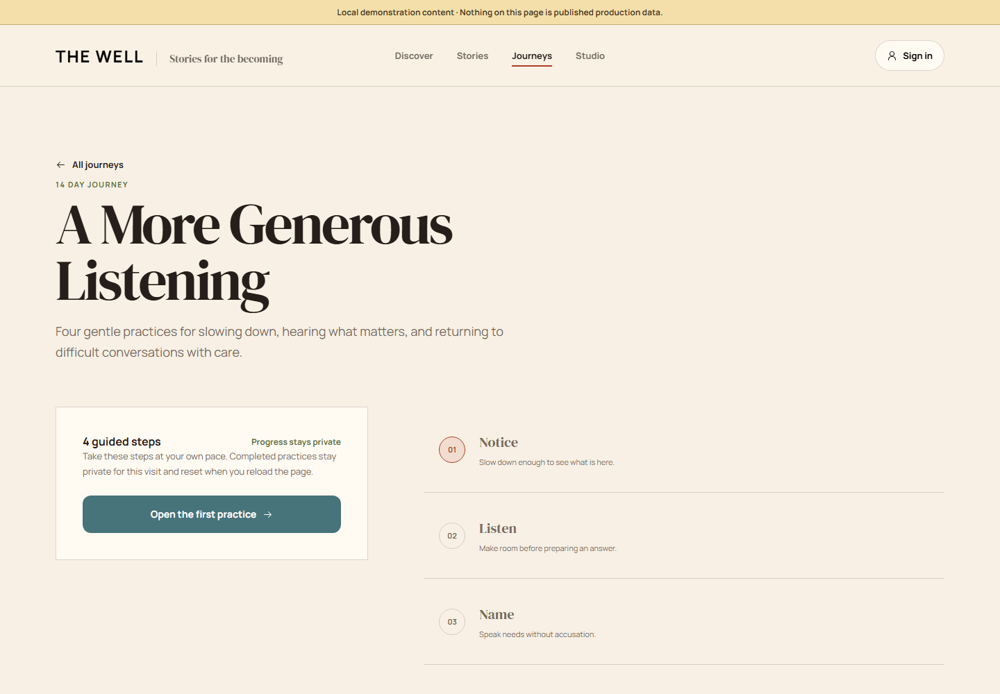

## 14. Practice

390 x 844. Healthy with scrolling. The practice prompt has clear hierarchy, and Scripture and completion continue below the fold.

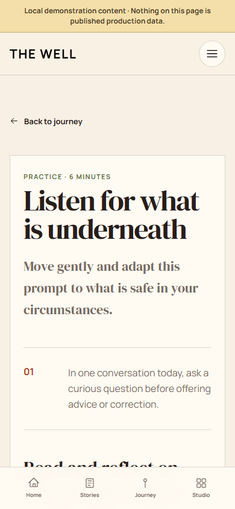

## 15. Completed practice

390 x 844. Healthy. Scripture reference, temporary-completion note, and completion action are visible together.

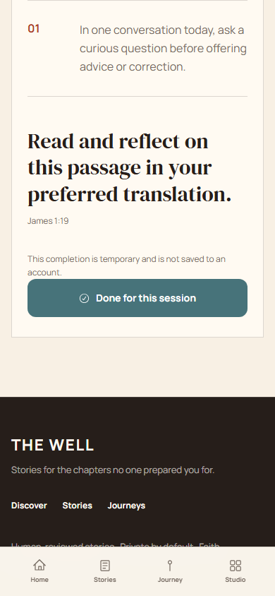

## 16. Production empty

1440 x 1000. Healthy. No sample story or invented publication appears outside explicit local demo mode. This capture used unconfigured local production mode.

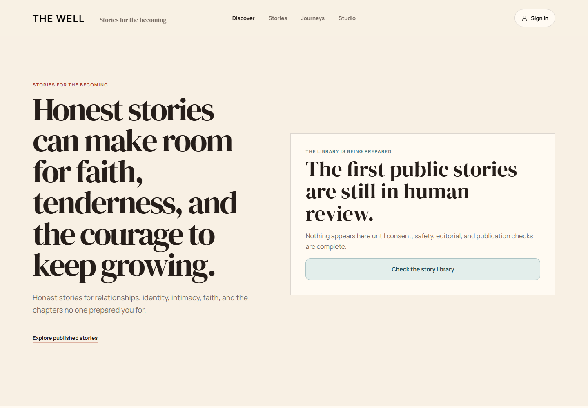

## 17. Episode unavailable

390 x 844. Healthy. An unavailable episode has a readable explanation and a direct return-to-stories action.

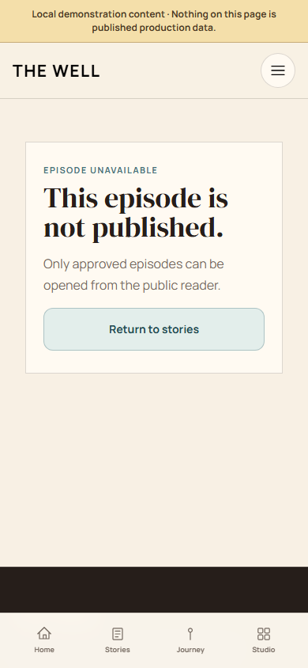

## 18. Series overview

390 x 844. Healthy. The expanded overview includes the series summary, ordered published parts, a quiet current-part highlight, and direct episode selection. It stays secondary to the story and fits above bottom navigation when scrolled into view.

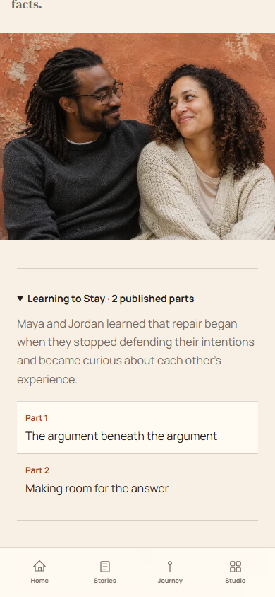
